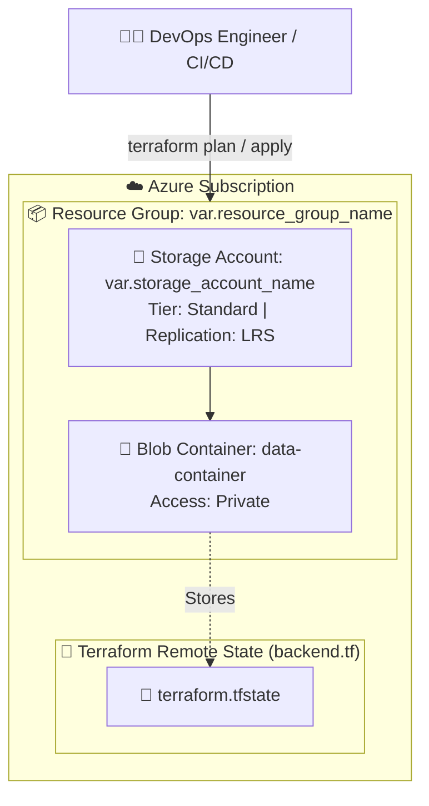

# ☁️ Azure Infrastructure with Terraform

[](https://www.terraform.io/)
[](https://registry.terraform.io/providers/hashicorp/azurerm/latest)
[](https://learn.microsoft.com/azure/developer/terraform/)
[](https://github.com/)

> **Infrastructure-as-Code (IaC)** project designed to automate the provisioning of core Azure resources including **Resource Groups**, **Storage Accounts**, and **Private Blob Containers**, along with centralized remote state management.

---

## 📑 Table of Contents

- [📌 Project Overview](#-project-overview)
- [🏗 Architecture](#-architecture)
- [📂 Repository Structure](#-repository-structure)
- [⚙️ Prerequisites](#️-prerequisites)
- [🚀 Getting Started](#-getting-started)
  - [1. Authenticate to Azure](#1-authenticate-to-azure)
  - [2. Configure Variables](#2-configure-variables)
  - [3. Deploy Infrastructure](#3-deploy-infrastructure)
- [🔐 Remote State Management](#-remote-state-management)
- [📋 Terraform Configurations](#-terraform-configurations)
  - [Inputs](#inputs)
  - [Outputs](#outputs)
- [🧹 Teardown & Cleanup](#-teardown--cleanup)
- [🛡️ Security & Best Practices](#️-security--best-practices)

---

## 📌 Project Overview

This repository provides modular, production-ready Terraform templates to stand up base cloud resources in Microsoft Azure:
- **Resource Group:** Logical boundary and lifecycle container for cloud resources.
- **Storage Account:** Scalable cloud storage (Standard LRS) for objects, blobs, and data files.
- **Blob Container:** Private container configured for safe data storage and state management.
- **Remote Backend:** Remote `azurerm` backend integration for team collaboration and state locking.

---

## 🏗 Architecture



---

## 📂 Repository Structure

```plaintext
azure-infrastructure/
├── .gitignore            # Git exclusion rules (ignores state files, secrets)
├── .terraform.lock.hcl   # Provider dependency lock file
├── backend.tf            # Azure remote backend configuration for state storage
├── main.tf               # Core resource definitions (RG, Storage, Container)
├── outputs.tf            # Output definitions for provisioned resources
├── providers.tf          # Terraform & AzureRM provider configuration
├── terraform.tfvars      # Environment-specific variable definitions
└── variables.tf          # Input variable schema and descriptions
```

---

## ⚙️ Prerequisites

Before executing the Terraform scripts, ensure you have the following installed and configured:

1. **[Terraform CLI](https://developer.hashicorp.com/terraform/downloads)** (v1.5 or newer)
2. **[Azure CLI (az)](https://learn.microsoft.com/cli/azure/install-azure-cli)**
3. An active **Azure Subscription** with permissions to create Resource Groups and Storage Accounts.

---

## 🚀 Getting Started

### 1. Authenticate to Azure

Login to your Azure account using Azure CLI:

```bash
az login
```

If you have multiple subscriptions, select the target subscription:

```bash
az account set --subscription "<YOUR_SUBSCRIPTION_ID_OR_NAME>"
```

Verify your active context:

```bash
az account show --output table
```

---

### 2. Configure Variables

Create or update your `terraform.tfvars` file with appropriate values:

```hcl
location             = "East US"
resource_group_name  = "rg-dev-azure-infra"
storage_account_name = "stdevazureinfra001"
```

> [!NOTE]
> Azure Storage Account names must be **globally unique across all Azure accounts**, between **3 to 24 characters in length**, and contain **only lowercase alphanumeric characters**.

---

### 3. Deploy Infrastructure

Run the standard Terraform workflow:

#### A. Initialize Terraform
Downloads the required `azurerm` provider and connects to the backend:
```bash
terraform init
```

#### B. Validate & Format
Check the syntax and formatting of your configurations:
```bash
terraform fmt
terraform validate
```

#### C. Plan Deployment
Preview the resources that will be created:
```bash
terraform plan
```

#### D. Apply & Provision
Deploy the infrastructure to your Azure subscription:
```bash
terraform apply
```
*(Type `yes` when prompted to confirm provisioning.)*

---

## 🔐 Remote State Management

The project is pre-configured with a remote backend in `backend.tf`:

```hcl
terraform {
  backend "azurerm" {
    resource_group_name  = "rg-dev-azure-infra"
    storage_account_name = "stdevazureinfra001"
    container_name       = "data-container"
    key                  = "terraform.tfstate"
  }
}
```

> [!TIP]
> **Initial Setup Strategy:**  
> When creating resources for the very first time, deploy them using a **local backend** first (temporarily comment out the `backend "azurerm"` block). Once the Resource Group, Storage Account, and Container exist in Azure, uncomment the block and run `terraform init -migrate-state` to migrate local state to Azure Blob Storage.

---

## 📋 Terraform Configurations

### Inputs

| Variable Name | Description | Type | Default | Required |
|:--------------|:------------|:----:|:-------:|:--------:|
| `location` | Azure region where resources are provisioned | `string` | — | **Yes** |
| `resource_group_name` | Name of the Azure Resource Group | `string` | — | **Yes** |
| `storage_account_name` | Globally unique storage account name (3-24 lowercase alphanumeric) | `string` | — | **Yes** |

### Outputs

| Output Name | Description |
|:------------|:------------|
| `resource_group_id` | Unique Resource ID of the provisioned Azure Resource Group |
| `resource_group_name` | Name of the provisioned Resource Group |
| `storage_account_id` | Unique Resource ID of the Storage Account |
| `storage_account_name` | Name of the Storage Account |
| `storage_account_primary_endpoint` | Primary Blob REST endpoint URL |

To view outputs at any time:
```bash
terraform output
```

---

## 🧹 Teardown & Cleanup

To destroy all provisioned infrastructure and avoid unnecessary cloud billing:

```bash
terraform destroy
```
*(Confirm with `yes` when prompted.)*

---

## 🛡️ Security & Best Practices

- 🔒 **Private Container Access:** Container access type is set to `private` (`container_access_type = "private"`) to avoid public data exposure.
- 🚫 **Secrets Management:** Sensitve variable files (`*.tfvars`) and state files (`*.tfstate`) are excluded in `.gitignore`.
- 📌 **Provider Pinning:** `providers.tf` explicitly locks the AzureRM provider version to avoid unexpected breaking changes.
- 📦 **State Locking:** Storing state files in Azure Blob Storage provides automatic distributed state locking using blob leases.

---

<div align="center">
  <b>Built for DevOps & Cloud Infrastructure Practice</b> 🚀
</div>

